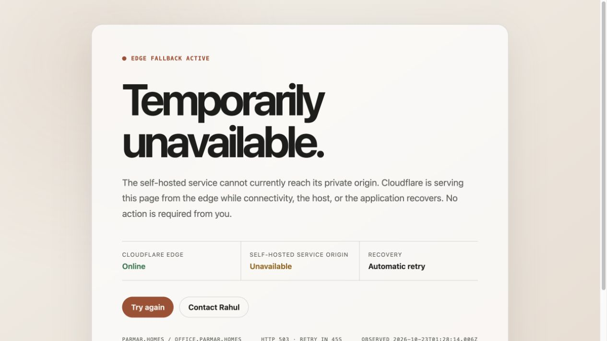
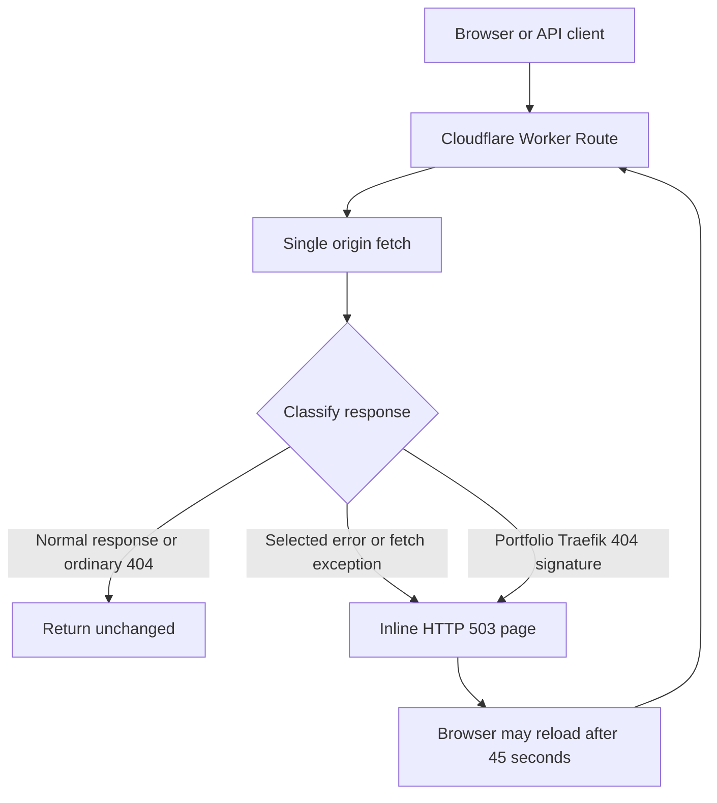

# Cloudflare Maintenance Fallback

[](https://github.com/RahulSinghParmar/maintenance-page/actions/workflows/check.yml)

An edge-hosted fallback for self-hosted services and a personal portfolio. A small Cloudflare Worker passes healthy responses through and returns a self-contained **HTTP 503** page when selected origin errors occur.



This is a real browser capture of [office.parmar.homes](https://office.parmar.homes/), not a mockup. That is an operational service and may recover; it is not a permanent outage demo. Built by [Rahul Singh Parmar](https://github.com/RahulSinghParmar).

## Features

- One origin fetch per incoming request; normal responses preserve their status, headers and body.
- Fallback for selected origin/Cloudflare errors and fetch exceptions.
- Portfolio-only heuristic for the plain-text 404 returned by an unrouted Traefik service.
- HTTP 503, `Retry-After: 45`, browser/CDN no-store directives and no-index headers.
- Inline HTML/CSS with no scripts, remote fonts, images or external template dependencies.
- Responsive light/dark styling, visible keyboard focus and reduced-motion support.
- A generic availability message that does not pretend to diagnose the private infrastructure.

## Architecture



**The current HTML is embedded in `src/index.js`.** It is not loaded from GitHub at runtime. Updating the page or classification rules requires a Worker deployment. A GitHub commit alone does not update production unless a separate deployment integration is configured.

## Response contract

| Origin result | Behavior |
| --- | --- |
| Healthy responses, redirects and ordinary application 4xx | Pass through unchanged |
| `500`, `502`, `503`, `504`, `520`, `521`, `522`, `523`, `524`, `525`, `526`, `530` | Maintenance HTML with HTTP 503 |
| Origin fetch throws | Maintenance HTML with HTTP 503 |
| Portfolio GET/HEAD matching the Traefik plain-text 404 heuristic | Maintenance HTML with HTTP 503 |
| `parmar.homes` application 404 | Preserve the application response |
| HEAD fallback | Same fallback headers with an empty body |

The 404 heuristic is limited to `rahulsinghparmar.site` and its subdomains. It is not independent proof that a container stopped. No Worker-level replay of non-idempotent requests is implemented.

## Check locally

Use a supported Node.js release; CI checks Node 22 and 24:

```sh
git clone https://github.com/RahulSinghParmar/maintenance-page.git
cd maintenance-page
npm run check
```

Tests use Node's built-in runner and mocked origin requests. No install, Cloudflare token or production outage is required. Node mocks do not replace tests in the Workers runtime.

## Deploy intentionally

Read the [operations runbook](docs/OPERATIONS.md) first. The documented pattern uses **Worker Routes in front of an existing origin**, not a Custom Domain that makes this fallback Worker the origin. Actual account/zone/route bindings are not tracked in `wrangler.json`.

```sh
npx wrangler dev
# Production mutation: run only after verifying account, Worker and routes.
npx wrangler deploy
```

Wrangler is currently unpinned; pin and validate it before adding reproducible release automation. Repository CI performs checks only and does not deploy Cloudflare.

## Documentation

- [Architecture and limits](docs/ARCHITECTURE.md)
- [Deployment, verification, troubleshooting and rollback](docs/OPERATIONS.md)
- [Review and prioritized improvements](docs/REVIEW.md)
- [Contributing](CONTRIBUTING.md) · [Security](SECURITY.md)

## Verified reference

On 23 October 2026 the office URL returned HTTP 503 with `Server: cloudflare`, `Retry-After: 45`, no-store directives and the expected security headers. The page matches the repository's response contract. Actual Cloudflare route bindings, DNS, deployed version and private-origin cause were not inspected.

No license is currently declared. A license choice remains a maintainer decision before advertising unrestricted reuse.
